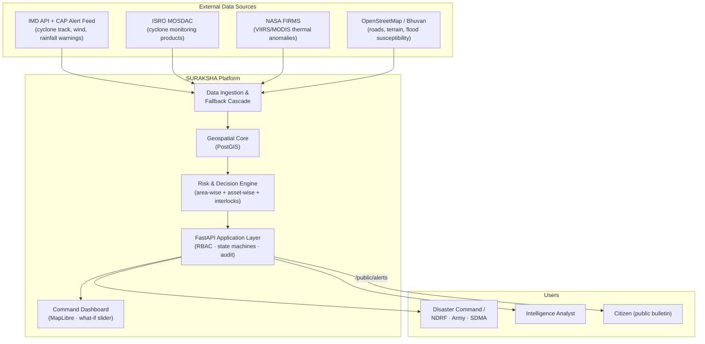
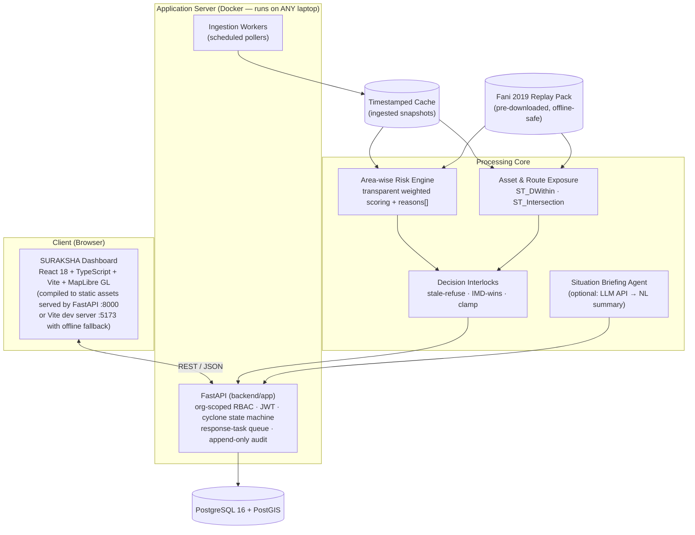
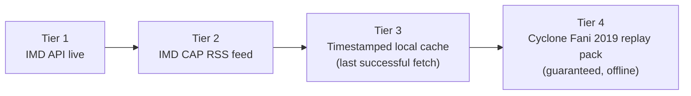
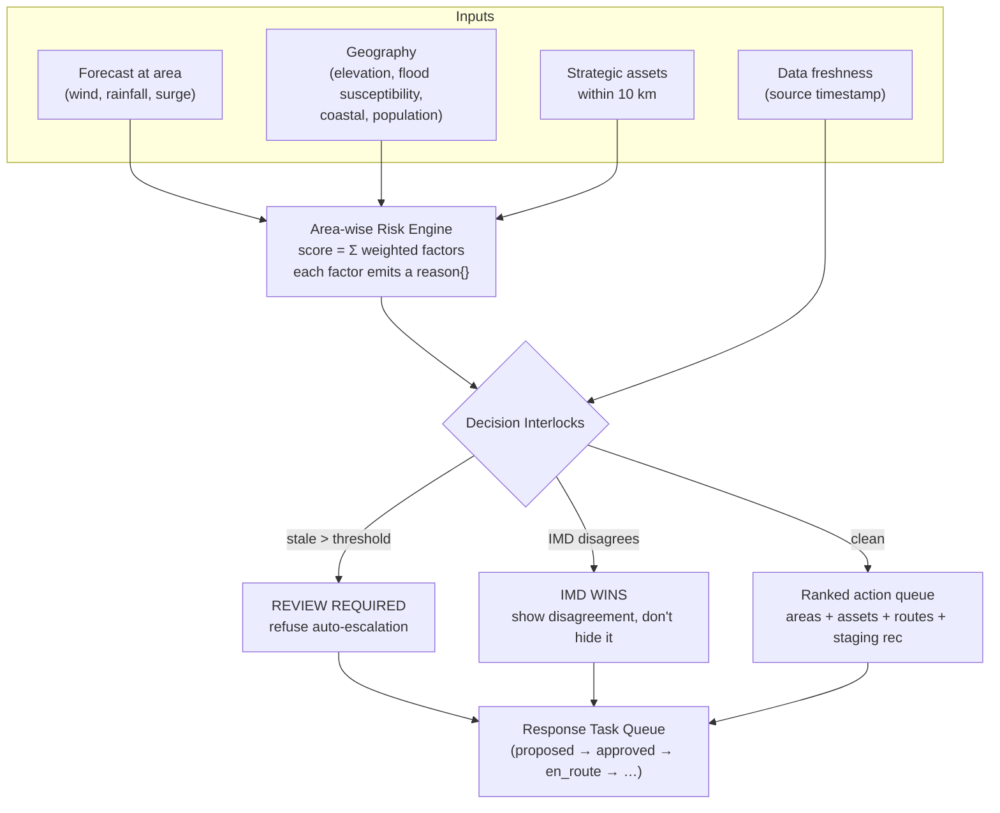
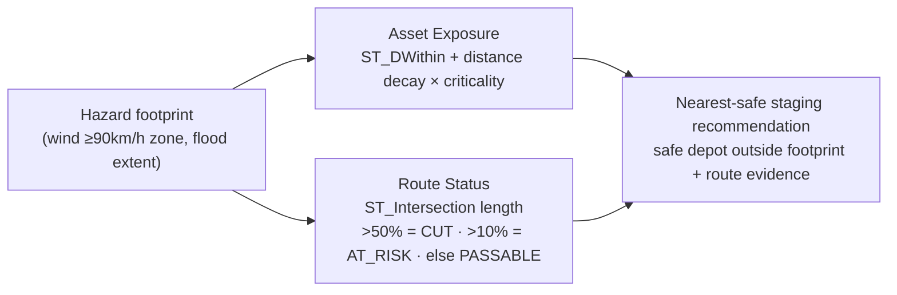

# SURAKSHA — System Architecture
**Satellite-to-Decision Disaster Intelligence for India's Response & Defence Forces**
Track: AI for Defence, Aerospace & National Security · Zinnovatio 4.0 · Oct 30–31, 2026

> **Design philosophy:** *Official warnings in, prioritised decisions out — and never the other way around.*
> Every score is explainable, every recommendation is provenance-tagged, and the platform supplements — never overrides — official warnings (IMD/ISRO/NDMA).

---

## 1. System Context



**One engine, many missions:** the same risk engine serves disaster-response command (this hackathon's demo), security-analyst anomaly verification, and later strategic asset protection — differentiated by `org_type` and role-shaped views, not by forking code.

---

## 2. Container Diagram



**Critical deployment fact:** the demo runs **entirely locally** (Docker Compose on one laptop). Venue wifi is optional, never required. The stack can run locally or deploy to cloud hosting seamlessly.

---

## 3. Data Fallback Cascade (AgriNexus pattern)

Every source resolves through a 4-tier cascade. The UI always displays which tier served the data (`provenance_tag`).



| Tier | Source | Latency | Demo role |
|---|---|---|---|
| 1 | IMD API (api.imd.gov.in, key in `.env`) | minutes | bonus, if venue wifi holds |
| 2 | IMD CAP RSS (cap-sources S3, open) | minutes | bonus |
| 3 | Local cache of last live fetch | — | partial live story |
| 4 | Fani 2019 replay (pre-seeded) | — | **the default demo** |

Rule: a failed tier never white-screens. It degrades and the banner updates: `LIVE — IMD` → `CACHED 14:32 IST` → `REPLAY: CYCLONE FANI (May 2019)`.

---

## 4. The Decision Engine (the core IP)



### 4.1 Area-wise risk score (0–100 priority score — NOT a probability)

| Factor | Weight | Source |
|---|---|---|
| Forecast wind exposure | 30% | IMD forecast intersected with block polygon |
| Rainfall + flood susceptibility | 20% | IMD rainfall × Bhuvan/NRSC susceptibility layer |
| Storm surge / coastal proximity | 15% | distance to forecast landfall, coastal flag |
| Population exposure | 20% | census block population |
| Critical infrastructure | 10% | count of strategic assets within 10 km |
| Urgency (time-to-impact) | 5% | <24h = 5, <48h = 3, else 1 |

Every factor appends to `reasons[]`: `{factor, weight, contribution, detail}`. **The reasons array is the product** — it feeds the UI drawer, the Situation Brief, and judge Q&A.

### 4.2 Decision Interlocks

1. **Stale-refuse:** source data older than threshold (default 6h) → no auto-escalation; force `REVIEW REQUIRED` state.
2. **IMD-wins-always:** if official warning and model score disagree, the official warning governs and the UI *shows* the disagreement.
3. **Never-assume-safe:** no route is `PASSABLE` without evidence; missing data = `UNKNOWN`, never "safe by default".
4. **Clamp:** never recommend a unit with `readiness < 0.4`; never `EVAC_ORDERED` with open interlock flags.
5. **Provenance everywhere:** every score/badge carries `OFFICIAL_FORECAST | OBSERVED | MODEL_ESTIMATE | REPLAY | SIMULATED | INSUFFICIENT_DATA` (specification in `docs/PROVENANCE_SPEC.md`).

---


## 5. Relief-Logistics Layer (light, spatial-only — no routing optimization)



Scope wall (do NOT cross): no convoy scheduling, no vehicle/fuel optimization, no inventory management, no pricing tiers.

---

## 6. Database Schema (summary — full DDL in `backend/app/db/migrations/` [alembic])

| Table | Purpose |
|---|---|
| `organizations` | multi-tenancy: `org_type` = disaster_authority / security_agency / infrastructure_operator |
| `users` | + `org_id`, role: admin / authority / analyst / responder / viewer |
| `hazard_events` | cyclone/fire/flood parent; `provenance_tag`, `data_freshness`, `status` |
| `areas` | Odisha blocks: geom, population, elevation, coastal, flood_susceptibility |
| `area_risk` | engine output: score, rank, `reasons[]`, `interlock_flags[]` |
| `strategic_assets` | relief stockpiles, NDRF bases, helipads, fuel depots, hospitals, ports, substations |
| `supply_routes` | OSM NH/rail segments |
| `asset_exposure`, `route_status` | engine output for logistics layer |
| `response_tasks` | simulated dispatch queue; `is_simulated = true` always |
| `incident_log` | append-only audit trail of state transitions & actions |

Cyclone-domain tables are **additive** alembic migrations extending the existing `backend/app/db/migrations/` chain. Existing FireSense tables are never dropped or altered destructively.

---

## 7. Cyclone State Machine

```
MONITORING → WARNING → EVAC_ORDERED → DEPLOYED → RESOLVED
                 ↘ STAND_DOWN (from WARNING)
```

- Transitions only via `PATCH /api/hazard-events/{id}/status`, logged to `incident_log`.
- `EVAC_ORDERED` requires `interlock_flags == []` — enforced at the state-machine layer, not the UI.

---

## 8. Repo Structure (the "reads like a product" layout)

```
suraksha/
├── AGENTS.md                   ← agent operating rules (all team AI sessions read this)
├── README.md                   ← badges, one-paragraph pitch, quickstart, benchmark table, disclaimers
├── ARCHITECTURE.md             ← this file
├── DECISIONS.md                ← 10 "why we chose X over Y" entries
├── RUNBOOK.md                  ← 24-hour team runbook
├── SRS.md                      ← pointer → docs/SRS.md (canonical)
├── docs/
│   ├── SRS.md                  ← software requirements specification
│   ├── JUDGE_QA.md             ← hostile questions + answers (20 defense answers)
│   ├── DEMO_SCRIPT.md          ← 5-minute timed walkthrough
│   ├── PROVENANCE_SPEC.md      ← 5 canonical tags + live/replay toggle spec
│   ├── SLIDES.md               ← 10-slide high-impact defense deck
│   └── REHEARSAL_GUIDE.md      ← timed execution breakdown & failure drills
├── backend/
│   ├── app/                     ← FastAPI application layer (authoritative)
│   │   ├── api/                 ← routers: hazard_events, area_risk, assets, routes, tasks, briefing
│   │   ├── services/
│   │   │   ├── risk/            ← area_engine.py, interlocks.py, exposure.py, briefing_template.py
│   │   │   └── ingest/          ← imd_adapter.py, cap_adapter.py, firms_adapter.py, cascade.py
│   │   ├── models/              ← SQLAlchemy models
│   │   └── core/                ← auth, RBAC, config
│   ├── app/db/migrations/       ← alembic (existing chain; cyclone tables = additive migrations)
│   └── workers/                 ← scheduled pollers
├── db/
│   └── seed/                    ← Fani 2019 replay pack + Odisha blocks + assets CSV + sources.md
│       ├── data/                ← fani_2019_track, warnings, odisha_blocks, population, osm_roads
│       ├── sources.md           ← per-file sources, licenses, and timestamps (< 50 MB)
│       └── strategic_assets.csv ← 42 curated installations with coordinates & criticality
├── frontend/
│   └── js/ + index.html         ← command dashboard (CDN Tailwind + MapLibre, ES modules)
├── data/                        ← pre-downloaded GeoJSON/CSV (gitignored where large)
├── legacy/                      ← frozen FireSense presentation artifacts (not part of the build)
├── seed_demo.py                 ← scenario seeder (imported by tests — keep at root)
├── docker-compose.yml           ← db + api (+frontend static served by FastAPI)
└── tests/                       ← pytest (including test_seed_data_pack, test_situation_briefing)
```

**Deliberate exclusions:** no `node_modules`/Vite, no JSX build chains, no decks/screenshots in root (they live in `legacy/`), no duplicate backends, no dead scripts.

---

## 9. Hardware & Performance Reality

- **No GPU is needed anywhere.** The LLM briefing agent calls an API (free tier), never local inference.
- **No Node build step.** The frontend is static files + CDN imports. Any laptop serves the full app with `docker compose up`. This eliminates build bottleneck issues.
- Everything identical across machines via Docker Compose.

---

## 10. Honesty Contract (non-negotiable, in README and on-screen)

1. Risk score = operational priority, NOT probability of disaster.
2. All dispatch is simulated (`is_simulated: true`); no real emergency integration exists.
3. Replay/simulated data is always visibly badged; live mode shows source + retrieval timestamp.
4. The platform supplements, never overrides, official warnings (IMD/ISRO/NDMA).
5. No claim of "illegal"/"hostile" activity — only "unmapped persistent heat source — flagged for verification."
