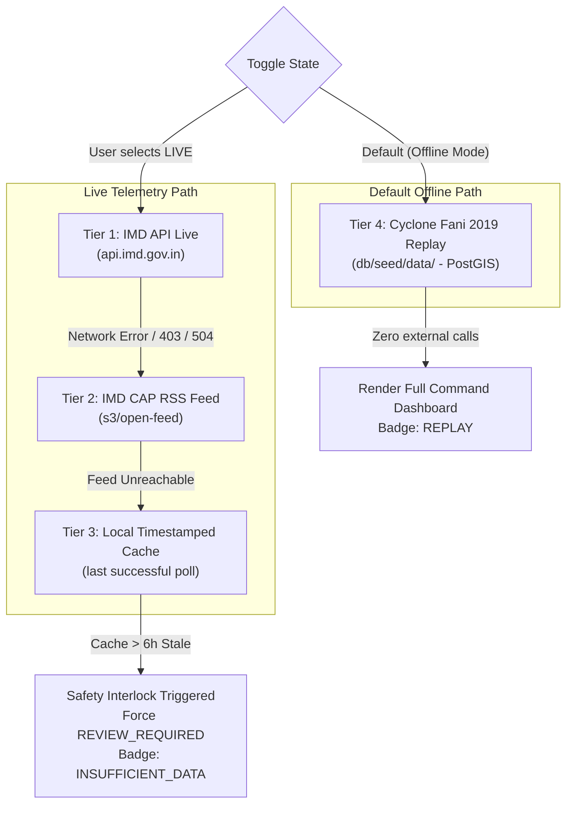

# SURAKSHA — Provenance Badge Specification & Live/Replay Toggle Architecture
**Deliverable:** Integration specification for M3 (Frontend/Map) and M2 (API Layer)  
**Version:** 1.0 (Locked for Hackathon MVP)  
**Author:** M4 (Data / Demo / Docs)  
**Honesty Contract:** Every score, metric, map layer, and dispatch task on screen **must** carry a visible, auditable provenance badge. Never display model estimates as official warnings, and never present historical replay data as live feeds.

---

## 1. The 5 Canonical Provenance Tags (Exact Strings)

The system defines exactly five canonical provenance tags plus one mandatory safety fallback. These strings must match **character-for-character** across database columns, API JSON responses, and frontend UI badges:

| # | Exact Tag String | Definition | Source Examples | UI Visual Archetype |
|---|---|---|---|---|
| 1 | `OFFICIAL_FORECAST` | Direct, unmanipulated forecast data issued by an authoritative national meteorological agency | IMD Cyclone Bulletins, IMD CAP alerts, RSMC New Delhi track outlook | Cobalt Blue / Official Seal (`bg-blue-900/60 text-blue-200 border-blue-500/50`) |
| 2 | `OBSERVED` | Verified historical or physical ground-truth observation, sensor recording, or surveyed infrastructure | OpenStreetMap roads, OSDMA asset catalog, surveyed hospital coordinates | Emerald Green / Verified Ground (`bg-emerald-900/60 text-emerald-200 border-emerald-500/50`) |
| 3 | `MODEL_ESTIMATE` | Derived prioritization score, spatial intersection result, or heuristic computed by the SURAKSHA engine | 6-factor area risk score, asset distance decay exposure, route cut ratio | Amber / Heuristic Alert (`bg-amber-900/60 text-amber-200 border-amber-500/50`) |
| 4 | `REPLAY` | Historical dataset replayed in an isolated, offline environment for scenario demonstration | Cyclone Fani May 2019 track, pre-seeded 2011 Census block populations | Purple / Historical Time Machine (`bg-purple-900/60 text-purple-200 border-purple-500/50`) |
| 5 | `SIMULATED` | Interactive what-if track perturbation, hypothetical hazard run, or mock dispatch task | Dragged cyclone track, simulated relief convoy dispatch, generated what-if re-ranking | Rose / Simulation Indicator (`bg-rose-900/60 text-rose-200 border-rose-500/50`) |
| * | `INSUFFICIENT_DATA` | Mandatory safety gate fallback: input feed is stale, conflicting, or missing required attributes | Data feed > 6h old, unverified road passability, missing coordinate fields | Slate Grey / Safety Gate (`bg-slate-800 text-slate-300 border-slate-600`) |

---

## 2. Frontend Component Specification (For M3)

### 2.1 CSS / Tailwind Token Matrix (Dark Theme Default)

```javascript
export const PROVENANCE_STYLES = {
  OFFICIAL_FORECAST: {
    bg: "bg-blue-950/80",
    text: "text-blue-300",
    border: "border-blue-500/60",
    dot: "bg-blue-400",
    icon: "shield-check",
    label: "OFFICIAL FORECAST",
    tooltip: "Sourced directly from official IMD meteorological bulletins. Governs all decisions."
  },
  OBSERVED: {
    bg: "bg-emerald-950/80",
    text: "text-emerald-300",
    border: "border-emerald-500/60",
    dot: "bg-emerald-400",
    icon: "map-pin",
    label: "OBSERVED",
    tooltip: "Verified spatial ground truth (OSM roads, OSDMA asset database)."
  },
  MODEL_ESTIMATE: {
    bg: "bg-amber-950/80",
    text: "text-amber-300",
    border: "border-amber-500/60",
    dot: "bg-amber-400 animate-pulse",
    icon: "calculator",
    label: "MODEL ESTIMATE",
    tooltip: "Algorithmic decision-support heuristic (0–100 priority score). Supplements, never replaces, official warnings."
  },
  REPLAY: {
    bg: "bg-purple-950/80",
    text: "text-purple-300",
    border: "border-purple-500/60",
    dot: "bg-purple-400",
    icon: "history",
    label: "REPLAY",
    tooltip: "Replayed from verified Cyclone Fani (May 2019) offline seed pack."
  },
  SIMULATED: {
    bg: "bg-rose-950/80",
    text: "text-rose-300",
    border: "border-rose-500/60",
    dot: "bg-rose-400 animate-ping",
    icon: "sparkles",
    label: "SIMULATED",
    tooltip: "What-if operational simulation or mock response task. Not connected to real emergency dispatch."
  },
  INSUFFICIENT_DATA: {
    bg: "bg-slate-900/90",
    text: "text-slate-300",
    border: "border-slate-600",
    dot: "bg-amber-500",
    icon: "alert-triangle",
    label: "INSUFFICIENT DATA",
    tooltip: "Safety Interlock: Stale or incomplete telemetry. Automated escalation refused; human review required."
  }
};
```

### 2.2 Reusable HTML/JS Badge Generator Function

M3 can drop this exact function into `frontend/` or `static/app.js`:

```javascript
/**
 * Renders a canonical SURAKSHA provenance badge.
 * @param {string} tag - One of the 5 canonical tags or INSUFFICIENT_DATA
 * @param {'sm'|'md'|'lg'} size - Badge sizing
 * @param {string} [extraInfo] - Optional timestamp or source note
 * @returns {string} HTML string
 */
export function renderProvenanceBadge(tag, size = 'sm', extraInfo = '') {
  const style = PROVENANCE_STYLES[tag] || PROVENANCE_STYLES.INSUFFICIENT_DATA;
  const sizeClasses = {
    sm: "px-2 py-0.5 text-xs font-mono tracking-wider",
    md: "px-2.5 py-1 text-xs font-mono tracking-wider",
    lg: "px-3 py-1.5 text-sm font-mono tracking-wide"
  }[size] || "px-2 py-0.5 text-xs font-mono";

  const note = extraInfo ? ` <span class="opacity-75 font-sans">(${extraInfo})</span>` : '';

  return `
    <span class="inline-flex items-center gap-1.5 rounded-full border ${style.bg} ${style.text} ${style.border} ${sizeClasses} shadow-sm backdrop-blur-sm select-none"
          title="${style.tooltip}" data-provenance="${tag}">
      <span class="inline-block w-1.5 h-1.5 rounded-full ${style.dot}"></span>
      <span class="font-bold uppercase">${style.label}</span>${note}
    </span>
  `;
}
```

---

## 3. UI Screen Mapping: Where Every Badge Lives

Every dashboard pane must carry an explicit badge so judges and commanders immediately know what tier they are evaluating:

```
+---------------------------------------------------------------------------------------------------------+
| [ SURAKSHA ]  Disaster Command | Mode: [ REPLAY: CYCLONE FANI ] (Toggle) | Safety: [ INTERLOCKS ARMED ] |
+---------------------------------------------------------------------------------------------------------+
| TOP BAR BANNER:                                                                                         |
| [REPLAY] Data Source: IMD Best Track 2019 | Landfall: Puri 08:30 IST | Venue Mode: 100% Offline         |
+----------------------------------------------------+----------------------------------------------------+
| LEFT: MAP CANVAS (MapLibre GL)                     | RIGHT: PRIORITISED ACTION QUEUE                    |
| - Cyclone Eye & Track: [REPLAY]                    | - Ranked Blocks Table:                             |
| - Wind Hazard Footprint (90km/h): [MODEL_ESTIMATE] |   Rank #1: Puri Sadar — Score: 92 [MODEL_ESTIMATE] |
| - Strategic Assets (Hospitals/Depots): [OBSERVED]  |   Click -> Reasons Drawer:                         |
| - Road Corridors (NH-316 / NH-53): [OBSERVED]      |     * Wind: 215 km/h [OFFICIAL_FORECAST]           |
|                                                    |     * Surge proximity: 2.1 km [OBSERVED]           |
|                                                    |     * Pop exposed: 238,000 [HISTORICAL]            |
|                                                    |     * Staging Rec: Cuttack Depot [MODEL_ESTIMATE]  |
|                                                    +----------------------------------------------------+
|                                                    | BOTTOM: RESPONSE TASKS & AUDIT TRAIL               |
|                                                    | - Task #101: Resupply Food to Puri [SIMULATED]     |
|                                                    |   Status: APPROVED | Audit Log: 14:32 IST          |
+----------------------------------------------------+----------------------------------------------------+
| SITUATION BRIEF PANEL:                                                                                  |
| [MODEL_ESTIMATE] Grounded briefing generated from verified risk outputs (Zero external calls)          |
+---------------------------------------------------------------------------------------------------------+
```

---

## 4. Live / Replay Toggle Architecture

### 4.1 The 4-Tier Fallback Cascade

The system implements the AgriNexus 4-tier cascade pattern. The demo machine defaults to **Tier 4 (Offline Replay)** to guarantee 100% survival on dead venue wifi:



### 4.2 Network Interlock & Automatic Graceful Degradation

If the presenter attempts to flip to `LIVE` during the 5th minute and the venue wifi dies:
1. **Immediate Timeout Interlock (1500 ms max):** The frontend poller times out after 1.5 seconds.
2. **Zero White-Screen Rule:** The UI never renders a blank map or spinner.
3. **Automatic Fallback:** The application immediately reverts to `CACHED` (Tier 3) or `REPLAY` (Tier 4).
4. **Banner Message:**
   ```
   [!] LIVE FEED UNREACHABLE — AUTOMATIC SAFETY FALLBACK ENGAGED
   System reverted to cached Cyclone Fani replay. Zero data loss.
   ```
5. **Demonstrable Judge Value:** In Minute 5 of the demo script, this behavior is a deliberate feature, proving that SURAKSHA refuses to fail when operational communications drop in a real cyclone.

---

## 5. Situation Brief Template Fallback Specification

### 5.1 Non-Functional Requirements
- **Latency:** < 10 ms execution time.
- **Network Dependency:** ZERO external HTTP/REST calls. Renders 100% offline.
- **Determinism:** The same input JSON must produce the exact same 6-line brief every single execution.
- **Safety Grounding:** Grounded only in structured system outputs (`hazard_event`, `reasons[]`, `cut_routes`, `staging_rec`).

### 5.2 The 6-Line Canonical Template Format

```
1. [EVENT STATUS]: Cyclone {name} ({category}) tracking at {speed_kmh} km/h with peak winds {wind_kmh} km/h towards {target_landfall}.
2. [TOP PRIORITY]: Block {top_block} ranked #1 (Score {top_score}/100) due to {top_block_reason}.
3. [CRITICAL ASSETS]: {asset_count} strategic facilities inside 90 km/h wind envelope, including {key_asset_names}.
4. [LOGISTICS & ACCESS]: {cut_route_count} supply corridors cut/compromised; {passable_route_count} primary arterial routes passable with evidence.
5. [STAGING RECOMMENDATION]: Position primary disaster relief staging at {staging_depot} ({staging_location}) outside hazard footprint.
6. [INTERLOCK STATUS]: {interlock_summary} | Provenance: {provenance_tag} as of {timestamp} IST | Advisory: Simulated Decision Support.
```
